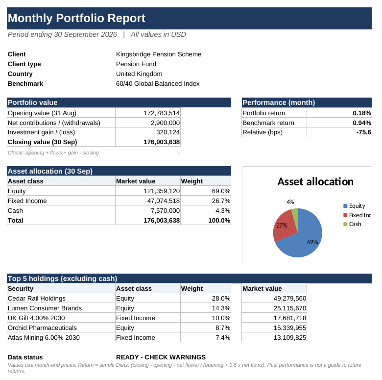
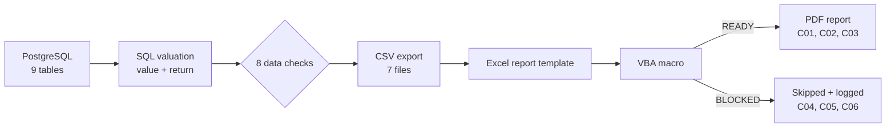

# ReportDesk: Institutional Client Reporting Pack

A monthly client reporting process for **6 institutional clients**: value every holding in **PostgreSQL**, calculate return vs benchmark, run **8 data-quality checks** before anything is reported, then build a customised report in **Excel** and create a **PDF only for clients whose data passed**, using **VBA**.

> **All data is synthetic.** Clients, securities, prices and values are invented. Known errors were added on purpose to test that the checks catch them.



## How it works



The rule is simple: **a wrong number must never reach a client.** A client with any BLOCKER does not get a report until the data is fixed.

## Results (September 2026 reporting month)

| What | Result |
| --- | --- |
| Clients | 6 (pension funds, insurer, foundation, sovereign fund) |
| Holding records valued | 133 (31 Aug and 30 Sep month-ends) |
| Total closing value | $1,433.0M |
| Data-quality exceptions | 7: **3 BLOCKER**, 4 WARNING |
| Reports created | 3 (C01, C02, C03), each flagged "confirm warnings before sending" |
| Reports blocked | 3 (C04, C05, C06) |
| On-time delivery (Jun–Aug) | 16 of 18 = **88.9%** (Jun 100%, Jul 83.3%, Aug 83.3%) |
| Open client queries | 6 of 16 |

## The 8 data-quality checks

| # | Check | Severity | Found this month |
| --- | --- | --- | --- |
| 1 | Held security has no month-end price | BLOCKER | C04: EQ002 has no 30 Sep price |
| 2 | Holding points to an unknown security | BLOCKER | none |
| 3 | Negative quantity | BLOCKER | none |
| 4 | Same security booked twice | BLOCKER | C06: EQ003 booked twice |
| 5 | Cash does not reconcile (opening + flows = closing) | BLOCKER | C05: difference of –1,250,000 |
| 6 | Benchmark return missing | BLOCKER | none |
| 7 | Stale price (same as last month) | WARNING | C02, C03, C06: FI001 |
| 8 | Price moved more than 25% in a month | WARNING | C01: EQ004 moved 38% |

Why blocking matters: C04's return shows **–18.6%** only because a ~$52M holding has no price, and C06 shows **+3.0%** only because a ~$9.9M holding is counted twice (about –0.27% without it). Neither number should reach a client.

## Return method

Simple Dietz, monthly:

```
Return = (Closing value − Opening value − Net flows) / (Opening value + 0.5 × Net flows)
Excess return (bps) = (Portfolio return − Benchmark return) × 10,000
```

Example, C01: (176,003,638 − 172,783,514 − 2,900,000) / (172,783,514 + 0.5 × 2,900,000) = **0.18%**, vs benchmark 0.94% → **–75.6 bps**.

## Repository structure (one folder per tool)

| Folder | Tool | What is inside |
| --- | --- | --- |
| [`sql/`](sql) | PostgreSQL | `01_setup.sql` creates 9 tables with data; `02_reporting_queries.sql` builds 6 views step by step |
| [`excel/`](excel) | Excel | Report template: one Report sheet driven by `Settings!B2` (INDEX/MATCH, SUMIFS) |
| [`vba/`](vba) | VBA | `GenerateClientReports` macro: PDF for READY clients, skip + log for BLOCKED |
| [`data/exports/`](data/exports) | CSV | The 7 query outputs used by Excel (and Power BI) |
| [`docs/images/`](docs/images) | | Sample report |

## SQL concepts used

- **LEFT JOIN** to keep holdings with a missing price, so the check can find them (an INNER JOIN would silently drop them)
- **UNION ALL** to stack 8 checks into one exceptions view
- **COUNT(\*) FILTER (WHERE …)** and **CASE WHEN** for BLOCKED / READY status
- **CTEs** for opening and closing values, and cash flows
- **Window functions**: `SUM() OVER (PARTITION BY client_id)` for allocation weights, `ROW_NUMBER()` for top 5 holdings
- **GROUP BY … HAVING COUNT(\*) > 1** for duplicates, **COALESCE** for clients with no flows

## How to run

1. **PostgreSQL (pgAdmin):** create a database `reportdesk`, open `sql/01_setup.sql` in the Query Tool and run it (F5).
2. Open `sql/02_reporting_queries.sql` and run it **one step at a time** (select a step, press F5).
3. Export the 7 queries in Step 8 to CSV.
4. **Excel:** open `excel/ReportDesk_Client_Report.xlsx`, save as `.xlsm`, and paste each CSV into its grey `Data_` sheet (values only).
5. **VBA:** press Alt+F11 → File → Import File → `vba/ReportDesk_Macros.bas`, then run `GenerateClientReports` (Alt+F8).
6. PDFs appear in a `Client_Reports` folder next to the workbook, and every client gets a line in `Report_Log`.

## Limitations and next steps

- Simple Dietz assumes flows happen mid-month; daily or time-weighted returns are more accurate when flows are large.
- Prices and holdings are loaded from scripts; a real process would load them daily from source systems.
- Next: a Power BI dashboard for the team view (AUM, deadlines, data issues, open queries), and a maker-checker review step before sending.

---
Author: **Salil Gokhale** · [LinkedIn](https://www.linkedin.com/in/salil-gokhale-analytics)
